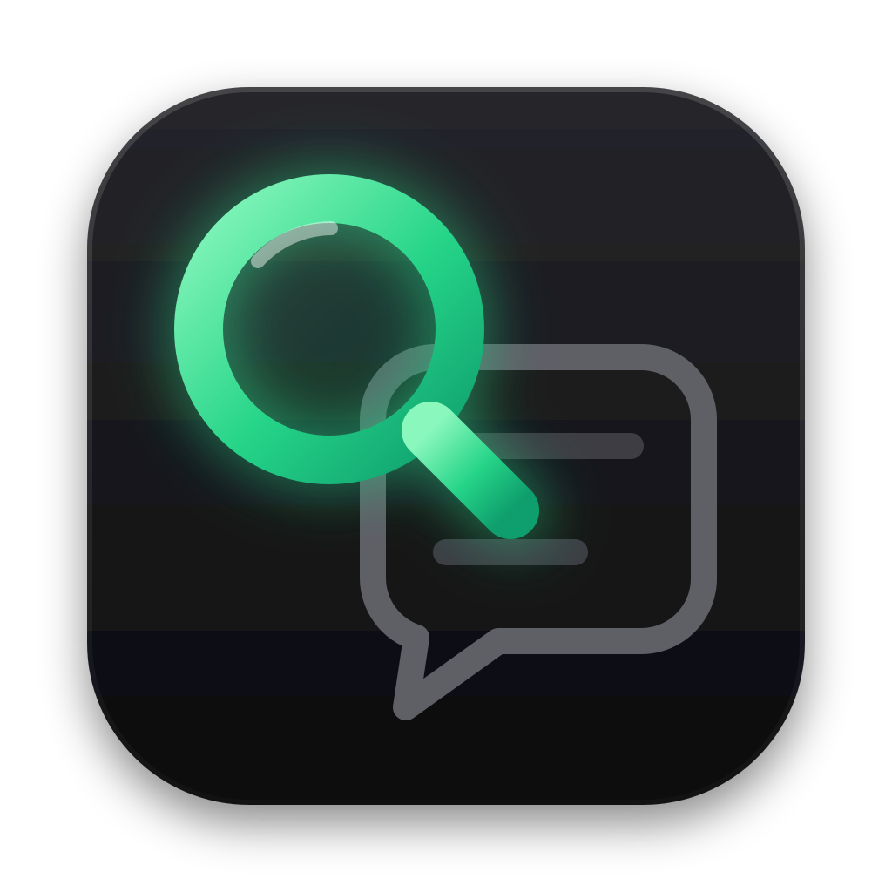

<p align="center">
  
</p>

<h1 align="center">wagrep</h1>

<p align="center">
  Search your WhatsApp history from the terminal, fast enough and compact enough<br>
  that your AI agent can dig through it for you.
</p>

<p align="center">
  <a href="https://github.com/marcosfons/wagrep/actions/workflows/ci.yml"></a>
  <a href="https://github.com/marcosfons/wagrep/releases/latest"></a>
  
  
  <a href="LICENSE"></a>
</p>

---

A lot of life happens in WhatsApp: the booking code a friend sent, the
decision made in a voice-note-heavy group, the PDF someone shared three weeks
ago. None of it is reachable from your editor or your agent.

wagrep reads the WhatsApp Desktop database already on your Mac and turns it
into something you (or Claude, Codex, any agent with a shell) can query:

```text
$ wagrep "LA 3021" -s 30d
== Beach trip (group)
-- 2026-10-28 Wed
#381102 14:05 Ana: did anyone book the LA3021 flight yet?
  > Bruno: I'll book it tonight
#381110 14:21 Bruno [audio 0:42 81.2K]
#381131 15:02 Carla [document booking.pdf 2p 157.3K]
  in file: ...Flight LA-3021 Departure 08:40 Seat 14C...
```

## Why it works well with agents

- **Answers in milliseconds.** Searches hit a local full-text index
  (SQLite FTS5), not a table scan. Typical queries take 5-10 ms; the index
  follows WhatsApp incrementally in the background of each call.
- **Never floods the context.** Inside an agent session the output is capped
  at ~10k characters. Instead of a million lines you get the newest matches
  that fit, plus a summary of the rest by chat, sender, type and day, with the
  exact flag to page back.
- **Forgiving search.** Accent- and case-insensitive (`marcio` finds
  `Márcio`). Codes like `LA3021` match with or without separators. A search
  with no hits retries tolerating typos (`churasco` finds `churrasco`) and
  says so.
- **Searches inside files.** Text in PDFs, spreadsheets, Word/PowerPoint
  documents and plain-text files people sent is indexed with the messages.
- **Shows what the app shows.** Who replied to what, reactions, edits, polls
  with vote counts, deleted messages, business messages, locations, and every
  attachment's type, length, size and page count.
- **Voice notes, on demand.** `wagrep transcribe <id>` turns a voice note
  into searchable text with Whisper. It never runs on its own, so an agent
  transcribes only the notes that matter.
- **One id for everything.** Each message prints as `#id`;
  `wagrep ctx/show/open/path <id>` takes it from there.
- **Read-only by construction.** WhatsApp's database is never opened, only
  cloned, and the clone is opened with writes denied at the SQLite level.
  wagrep cannot send, edit or delete anything, and nothing leaves your Mac.

## Install

Needs macOS with WhatsApp Desktop signed in, and Python 3.9+ (the one macOS
ships works; no packages).

```sh
git clone https://github.com/marcosfons/wagrep.git
cd wagrep && make install   # symlinks wagrep into ~/.local/bin
wagrep index                # first run: builds the index (about a minute)
```

Update with `git pull` (the index upgrades itself when needed); remove with
`make uninstall` and `rm -rf ~/.cache/wagrep`.

Give your terminal **Full Disk Access** (System Settings > Privacy & Security),
since WhatsApp's data lives in a protected container. Optional extras:
`brew install poppler` (text inside PDFs) and `brew install fzf` (`wagrep pick`).

## Use

| | |
|---|---|
| `wagrep invoice -c Ana -s 7d` | messages with "invoice" in Ana's chat this week |
| `wagrep -x "Beach trip" -d today` | today's conversation, in order |
| `wagrep -o proposal contract` | messages with either word |
| `wagrep --files budget` | documents named or containing "budget" |
| `wagrep -T audio -c Bruno -n 5` | last voice notes, with durations |
| `wagrep chats beach` | find a chat by name |
| `wagrep ctx 381131` | the conversation around a message |
| `wagrep open 381131` | open its attachment (`-R` reveals it in Finder) |
| `wagrep stats -c beach -s 2026-10` | who talked, when, about how much |
| `wagrep pick` | browse everything interactively with fzf |

`wagrep -h` lists every flag; `wagrep guide` is the reference written for agents.

## Index only what you care about

By default everything is indexed (about 100 MB for 330k messages). Most of
that is old history you rarely search, so you can keep recent messages and
choose which chats keep their past:

```sh
wagrep index --default 60d --archived skip   # last 2 months, archived chats out
wagrep chats --keep "Ana"                    # this chat's full history
wagrep chats --keep "Book club" --span 1y    # or a year of it
wagrep chats --skip "Promotions"             # never index this one
```

That brought one real index from 104 MB to 26 MB. Rules live in
`~/.config/wagrep/config.ini`; old messages leave the index as they age past
the window. When a search reaches outside what is indexed, wagrep says so and
prints the `--keep` command, so nothing silently looks like "never said".

## Voice notes

Transcription is opt-in and explicit: nothing is sent anywhere until you (or
your agent) ask for specific messages. Pick one backend:

```sh
wagrep transcribe --setup api --url https://api.openai.com/v1 --key sk-...
        # or Groq, or your own OpenAI-compatible Whisper server
wagrep transcribe --setup local --language pt
        # faster-whisper on this Mac: ~2 GB download, needs Python 3.10-3.13 and ffmpeg
```

Then `wagrep transcribe 381110 381131`. Transcripts are kept in
`~/.local/share/wagrep`, show up inline as `(transcript) ...`, and are
searchable like any message. Add a `prompt = ...` line under `[whisper]` in
`~/.config/wagrep/config.ini` with a sentence in your language and the names
you use: Whisper copies its spelling and style.

## Teach your agent

Add this to your `CLAUDE.md` (or `AGENTS.md`). It costs a few dozen tokens:

```markdown
- **`wagrep`**: my WhatsApp history, read-only. Use it when context may live in
  chats (people, decisions, codes, files sent). `wagrep chats NAME`, then
  `wagrep TERMS -c CHAT -s 7d`; `#ID`s feed `ctx`/`show`/`open`/`path`.
  Follow the stderr hints to narrow. Voice notes: `wagrep transcribe ID...`
  only when one matters (slow, may cost money). Details: `wagrep guide`.
```

## How it works

```
WhatsApp's ChatStorage.sqlite --clone--> ~/.cache/wagrep snapshot --decode--> index.db (FTS5)
```

Each run compares WhatsApp's file signature with the last sync. If it changed,
only the rows whose Core Data change counter moved are decoded again (reply
threads, reactions, edits and polls live in protobuf blobs that wagrep parses
itself). Everything stays in `~/.cache/wagrep`: about 100 MB for 330k messages
and 900 documents, because text is stored once and the search index only keeps
which 3-letter chunks each message contains. Logs go to `logs/wagrep.log`.

## Not yet

- **WhatsApp for Windows and WhatsApp Web.** They keep messages in other
  stores (WhatsApp Web in encrypted IndexedDB), so they need their own reader.
  Only `src/wa.py` knows about the macOS database; another source fills the
  same index.
- **View-once media** is not identified in the database yet.

## Privacy

Everything stays on your Mac, and wagrep cannot change anything in WhatsApp.
The only thing that ever leaves is a voice note you explicitly ask
`wagrep transcribe` to send to an API you configured. Details and how to report
a problem: [SECURITY.md](SECURITY.md).

## License

[MIT](LICENSE). Not affiliated with WhatsApp or Meta. Changes are listed in
[CHANGELOG.md](CHANGELOG.md).
